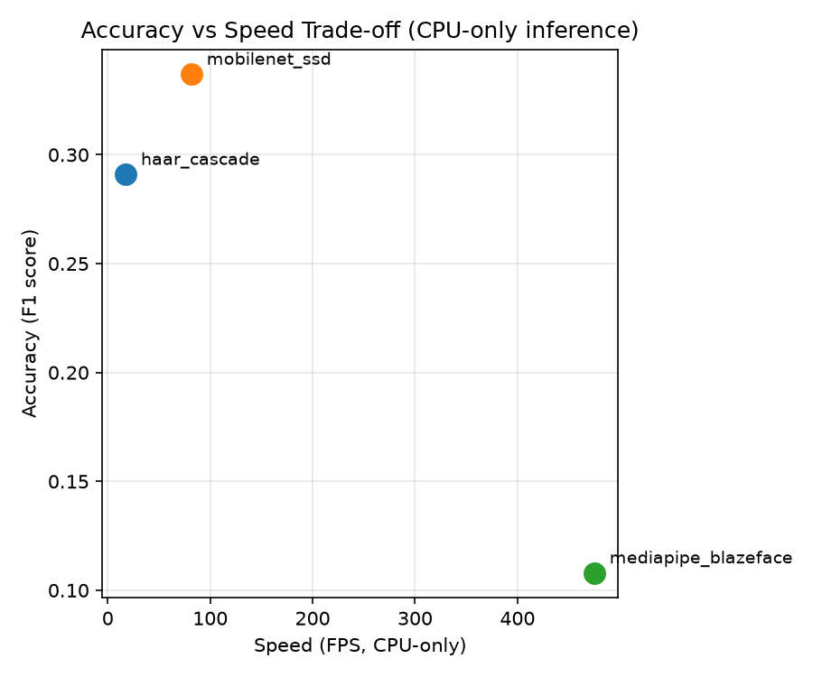
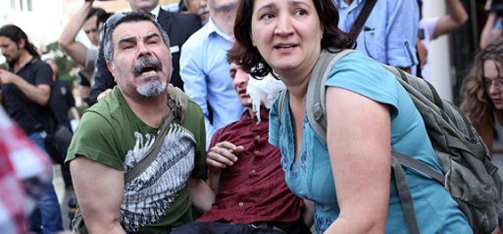

# Green & Efficient Face Anonymization on CPU

Accuracy-vs-efficiency benchmark of three CPU-only face detectors (Haar Cascade,
OpenCV MobileNet-SSD, MediaPipe BlazeFace) applied to a privacy-preserving
face-anonymization pipeline — built with resource-constrained, GPU-free
deployment in mind.

> Course project for **Multimedia Technology** (7th Semester). Applications
> Track: applying computer-vision models to a privacy-preservation problem
> under a hard CPU-only / green-computing constraint.

## Why this project

Public and CCTV footage is often shared or stored without anonymizing faces,
raising privacy concerns. Heavy deep-learning face detectors are usually
benchmarked on GPUs, but most real-world edge cameras and low-cost devices
only have a CPU. This project asks: **which lightweight face detector gives
the best accuracy-per-unit-of-compute when anonymizing faces on CPU-only
hardware?**

## Results at a glance

Evaluated on 60 WIDER FACE validation images (463 ground-truth faces),
IoU >= 0.5, benchmarked on CPU-only inference.

| Detector | Model Size | FPS | Latency (ms/frame) | Precision | Recall | F1 |
|---|---|---|---|---|---|---|
| Haar Cascade | 0 MB (built-in) | 17.7 | 56.5 | 0.548 | 0.198 | 0.291 |
| MobileNet-SSD | 10.2 MB | 81.8 | 12.2 | **0.972** | 0.204 | **0.337** |
| MediaPipe BlazeFace | 0.2 MB | **475.2** | **2.1** | 0.769 | 0.058 | 0.108 |



**Takeaway:** MobileNet-SSD gives the best accuracy/F1; BlazeFace is ~27x
faster and the smallest model but loses recall on dense/small-face crowd
scenes (it's tuned for close-range faces); Haar Cascade needs zero extra
model weight but is the slowest and least precise. There is no single
"best" detector — only an explicit speed/accuracy/footprint trade-off,
which is exactly what the experiment set out to measure. Full write-up in
[`results/RESULTS_SUMMARY.md`](results/RESULTS_SUMMARY.md).

Sample anonymization output (Gaussian blur), produced by [`src/anonymize.py`](src/anonymize.py):

| Original | Anonymized (MobileNet-SSD) |
|---|---|
|  |  |

## Project structure

```
.
├── src/
│   ├── detectors/
│   │   ├── haar.py                 # Haar Cascade (Viola-Jones) wrapper
│   │   ├── mediapipe_blazeface.py  # MediaPipe BlazeFace wrapper
│   │   ├── mobilenet_ssd.py        # OpenCV DNN MobileNet-SSD wrapper
│   │   └── download_models.py      # fetches pretrained weights (gitignored)
│   ├── data_prep.py        # downloads WIDER FACE + builds the evaluation sample
│   ├── anonymize.py        # blur / pixelate given detected face boxes
│   ├── benchmark.py        # FPS, latency, CPU%, memory per detector
│   ├── evaluate.py         # precision / recall / F1 vs ground truth (IoU matching)
│   └── make_plots.py       # combines results into tables + charts
├── results/                 # generated CSVs, plots, before/after samples
├── requirements.txt
└── README.md
```

## Setup

Requires Python 3.10+ (tested on 3.13). No GPU needed.

```bash
python3 -m venv venv
source venv/bin/activate        # Windows: venv\Scripts\activate
pip install -r requirements.txt
```

## Usage

Run once, in order, from the `src/` directory:

```bash
cd src
python detectors/download_models.py   # fetch pretrained weights (~11 MB)
python data_prep.py                   # download WIDER FACE sample + ground truth
python anonymize.py                   # generate before/after demo images
python benchmark.py                   # FPS / CPU / memory per detector
python evaluate.py                    # precision / recall / F1 per detector
python make_plots.py                  # combined table + charts
```

All outputs are written to `results/`.

To benchmark on your own video instead of the WIDER FACE sample, drop an
`.mp4` at `data/own_video.mp4` — `benchmark.py` auto-detects it.

## Method

Each detector implements the same interface:

```python
def detect_faces(frame_bgr: np.ndarray) -> list[tuple[int, int, int, int]]:
    """Returns (x, y, w, h) boxes in pixel coordinates."""
```

This makes the three detectors interchangeable in `anonymize.py`,
`benchmark.py`, and `evaluate.py`. Detected boxes are anonymized via
Gaussian blur or pixelation (`src/anonymize.py`).

Three detectors were chosen specifically because each represents a
different point on the classical-vs-deep, light-vs-heavy spectrum, all of
which run on CPU without training:

- **Haar Cascade** — classical, no learned weights, instant to load.
- **MediaPipe BlazeFace** — a deep model purpose-built for mobile/edge CPUs.
- **MobileNet-SSD (res10)** — a compact deep detector, heavier than
  BlazeFace but more accurate on this dataset.

Heavier state-of-the-art detectors (e.g. RetinaFace, MTCNN) were
deliberately excluded: they need a GPU for real-time throughput, which
conflicts with this project's CPU-only / green-computing constraint.

## Data

- **WIDER FACE** (validation split, CUHK-CSE) — a 60-image random subset
  with ground-truth bounding boxes, used for the precision/recall/F1
  evaluation. Not redistributed in this repo (see its own license); run
  `src/data_prep.py` to download and regenerate it locally.
- Pretrained model weights are likewise not committed — run
  `src/detectors/download_models.py` to fetch them (see **Usage** above).

## Limitations & future work

- Evaluated on a 60-image sample for CPU/time budget reasons; a larger
  sample would tighten the precision/recall estimates.
- BlazeFace's recall is evaluated on WIDER FACE's crowd scenes, which are
  outside its intended close-range use case — results would look different
  on a selfie/webcam-style dataset.
- Future work: deploy the best trade-off detector on an actual edge device
  (e.g. Raspberry Pi) for a real power/energy measurement, and extend
  anonymization to audio (voice) for full audio-visual privacy.

## Acknowledgments

- [WIDER FACE](http://shuoyang1213.me/WIDERFACE/) dataset (Yang et al., CVPR 2016)
- [MediaPipe](https://github.com/google-ai-edge/mediapipe) Face Detector (Google)
- [OpenCV](https://opencv.org/) Haar Cascade and DNN face-detector models

## License

Code in this repository is released under the MIT License (see `LICENSE`).
The WIDER FACE dataset and the MediaPipe/OpenCV pretrained models retain
their own original licenses.
